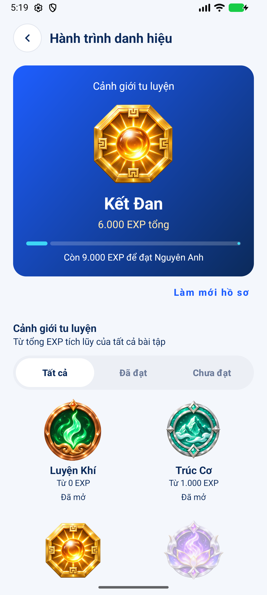
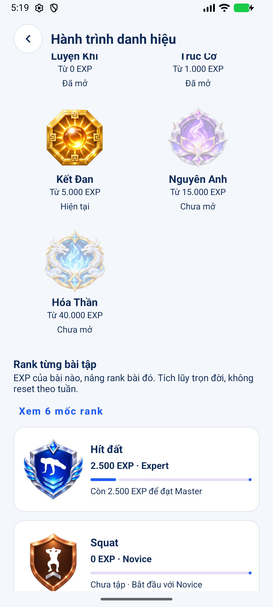

# Cảnh giới và rank từng bài — bàn giao

## Quy tắc v1

Tổng EXP tài khoản quyết định cảnh giới; EXP tích lũy riêng từng bài quyết định rank của bài đó. Hai hệ thống không dùng điểm BXH mẫu, streak hoặc số buổi. Công thức cộng EXP của server không thay đổi.

| Cảnh giới | EXP tổng tối thiểu |
|---|---:|
| Luyện Khí | 0 |
| Trúc Cơ | 1.000 |
| Kết Đan | 5.000 |
| Nguyên Anh | 15.000 |
| Hóa Thần | 40.000 |

| Rank từng bài | EXP bài đó tối thiểu |
|---|---:|
| Novice — Nhập môn | 0 |
| Intermediate — Trung cấp | 200 |
| Advanced — Nâng cao | 750 |
| Expert — Chuyên gia | 2.000 |
| Master — Cao thủ | 5.000 |
| Grandmaster — Đại cao thủ | 12.000 |

Mốc bằng ngưỡng đã thuộc bậc mới. 0 EXP là bậc khởi đầu; bài chưa tập ghi rõ “Chưa tập”. Không trừ EXP khi nghỉ tập, không reset theo tuần. Thanh tiến độ thể hiện khoảng từ bậc hiện tại đến bậc kế tiếp, bậc cuối đạt 100%.

Ví dụ: 6.000 EXP tổng → Kết Đan; hít đất 2.500 EXP → Expert; Squat 0 EXP → Novice.

## Luồng sử dụng

Hồ sơ → Xem huy hiệu → Hành trình danh hiệu. Dải huy hiệu ở Hồ sơ dùng cùng mốc cảnh giới. Màn chi tiết có tổng EXP, mốc kế tiếp, 5 cảnh giới, lọc đã/chưa đạt, và danh sách rank theo từng bài. Bấm bài tập để xem 6 mốc rank của bài đó; nút “Xem 6 mốc rank” mở bảng mốc chung.

API `users/me/achievements` trả tổng trọn đời từ database, không lấy 50 buổi trên màn Lịch sử để đoán rank. Tải lại sau khi lưu buổi tập để xem EXP mới. Không cộng EXP khi chỉ mở màn hoặc bấm làm mới.

## Triển khai và thứ tự merge

1. PR #18 hoàn thiện phần B hiện có.
2. PR #19 API danh hiệu: base hiện tại `codex/b-settings-social`. Sau khi #18 merge, đổi base sang `develop`, kiểm tra diff/CI trước khi merge.
3. PR giao diện danh hiệu: base `codex/b-achievement-api`. Sau khi #19 merge, đổi base sang `develop`, kiểm tra diff/CI trước khi merge.
4. Trưởng nhóm triển khai backend mới lên Azure trước khi nghiệm thu rank bằng tài khoản thật. Không có migration mới. Phiên làm việc này không triển khai Azure.

Trong lúc server chưa có endpoint, cảnh giới vẫn hiển thị từ hồ sơ đã tải; rank hiện thông báo chưa tải được và nút thử lại, không tạo điểm/rank giả. Sau một lần tải thành công, lỗi tải tiếp theo giữ dữ liệu cũ và báo rõ đó là lần tải trước. Không lưu cache rank xuyên tài khoản.

## Checklist kiểm thử thủ công

- [ ] Vào Hồ sơ: tên cảnh giới và dải 5 huy hiệu đúng tổng EXP.
- [ ] Vào Huy hiệu: ảnh rõ, tên/ngưỡng đọc được; cuộn đến cuối màn hình.
- [ ] Lọc Tất cả / Đã đạt / Chưa đạt; xoay màn hình vẫn giữ bộ lọc.
- [ ] Các bài chưa tập có 0 EXP, Novice và “Chưa tập”.
- [ ] Lưu một buổi hít đất thành công, làm mới: tổng EXP tăng, EXP hít đất tăng; Squat không đổi.
- [ ] Kiểm tra sát mốc, đúng mốc, vượt mốc; ví dụ 199/200/201 EXP hít đất. Dùng dữ liệu test riêng, không sửa dữ liệu tài khoản thật để giả mốc.
- [ ] Bấm từng bài: bảng 6 rank có ảnh và đánh dấu bậc hiện tại; đóng và xoay màn hình không lỗi.
- [ ] Bậc cuối hiển thị đạt tối đa, không có “EXP còn lại” âm.
- [ ] Mất mạng trước lần tải đầu: không xuất hiện rank/EXP giả; thử lại có mạng tải được.
- [ ] Mất mạng sau lần tải thành công: giữ dữ liệu cũ và hiện thông báo dữ liệu lần trước.
- [ ] Đăng xuất, đăng nhập tài khoản khác: không còn rank của tài khoản cũ.
- [ ] Nút quay lại về Hồ sơ; chữ lớn trong cài đặt thiết bị vẫn đọc và cuộn được.

## Kiểm thử tự động

- Backend: CI PostgreSQL thật, `mvn verify`, 14 test đạt, gồm 4 test danh hiệu; build Docker thành công (run 42598287774).
- Android unit: 49 test đạt, gồm các biên ngưỡng, EXP âm/lớn, độc lập giữa bài, hợp đồng API và payload thiếu.
- Android API 37: 22 test đạt, 1 test đổi mật khẩu live được bỏ qua vì không cung cấp tài khoản live; 0 lỗi. Có kiểm tra tải ban đầu chưa có hồ sơ, xoay màn, lọc, retry, dữ liệu cũ, hai bài rank độc lập, hộp thoại và asset có alpha.
- Lint: 0 lỗi, 282 cảnh báo toàn dự án. Build debug thành công.
- Không dùng tài khoản thật để tạo buổi tập giả; fixture kiểm thử được tiêm vào ViewModel, không đóng gói vào luồng sản phẩm.

## Hình ảnh

11 asset PNG tách nền nằm ở `app/src/main/res/drawable-nodpi/`; nguồn và prompt tại [ACHIEVEMENT_ART.md](ACHIEVEMENT_ART.md). Ảnh giao diện minh họa bên dưới dùng fixture kiểm thử (6.000 EXP), không phải thành tích tài khoản thật.

