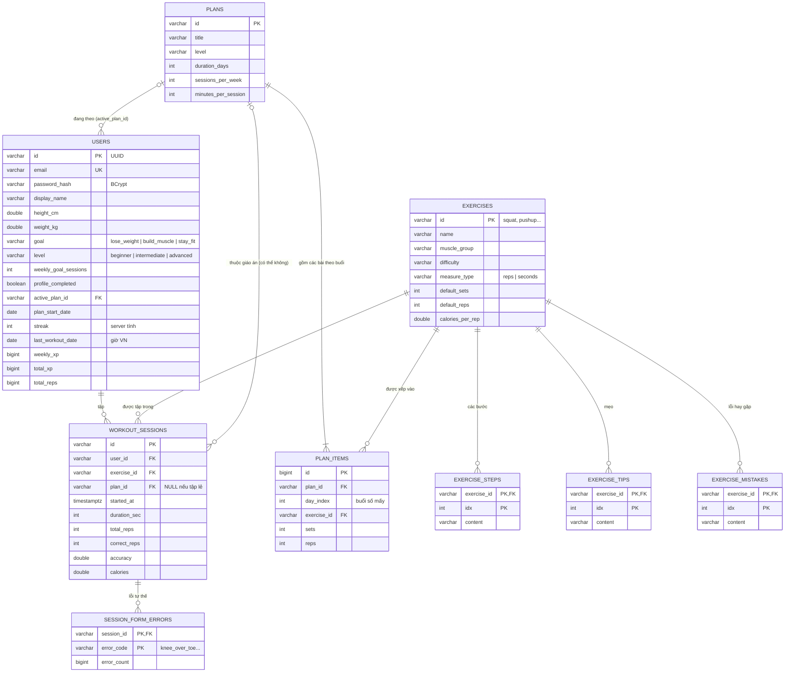

# Database AI Coach

PostgreSQL 16 chạy trong Docker trên máy ảo Azure (container `db`, không mở cổng ra Internet). **10 bảng**, chia 4 nhóm: người dùng, bài tập, giáo án, buổi tập.

Cấu trúc bảng nằm trong code, không tạo tay: Flyway chạy các file SQL trong [`backend/src/main/resources/db/migration/`](../backend/src/main/resources/db/migration/) theo thứ tự khi server khởi động.

| File | Nội dung |
|---|---|
| `V1__init_schema.sql` | Tạo 10 bảng, khoá chính, khoá ngoại bảng con, unique email, index `(user_id, started_at)` |
| `V2__relations.sql` | Khoá ngoại giữa bảng chính, ràng buộc `correct_reps ≤ total_reps`, index cho lịch sử và giáo án |

## Sơ đồ quan hệ (ERD)

## API Trang chủ đọc từ đâu

`GET /api/v1/home` trả cả 2 khối thầy chấm trong một lần gọi:

| Khối trong JSON | Đọc bảng | Cách tính |
|---|---|---|
| **Chuỗi 7 ngày** — `streak`, `week` | `users` (streak, last_workout_date, weekly_goal_sessions) + `workout_sessions` của tuần này | 1 truy vấn theo index `(user_id, started_at)` từ thứ Hai đến Chủ nhật, giờ Việt Nam → ngày nào có tập. Streak = số ngày tập liên tiếp, cập nhật mỗi lần lưu buổi tập; lần tập cuối trước hôm qua thì hiển thị 0 |
| **Bài tập hôm nay** — `todayWorkout` | `users.active_plan_id` → `plans` + `plan_items` + `exercises`, đếm số ngày đã tập theo giáo án trong `workout_sessions` | Buổi tiếp theo = buổi thứ (số ngày đã tập + 1) của giáo án. Chưa chọn giáo án → 3 bài gợi ý Squat, Hít đất, Plank lấy từ `exercises` |

## Dữ liệu nền

Mỗi lần khởi động, server nạp (ghi đè) 9 bài tập và 3 giáo án. Lần đầu tạo thêm tài khoản `demo@aicoach.vn` / `Demo1234` có 8 ngày tập để demo Trang chủ. Bảng `users`, `workout_sessions` của người dùng thật không bao giờ bị ghi đè.

## Quy tắc khi cần đổi cấu trúc bảng

1. Thêm file mới `V3__mo_ta_ngan.sql` (số tăng dần). **Không sửa** V1, V2 — Flyway lưu checksum, sửa file đã chạy là server từ chối khởi động.
2. Sửa entity Java tương ứng. Hibernate chạy ở chế độ `validate`: entity lệch bảng là báo lỗi ngay.
3. Push → Backend CI chạy Flyway + test trên PostgreSQL thật → xanh mới merge.
