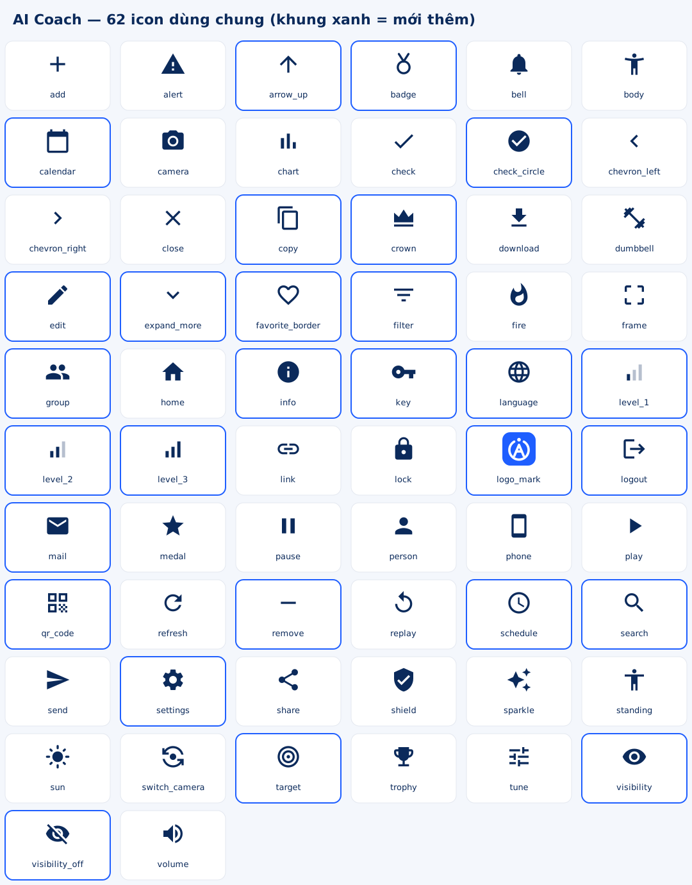

# Bộ icon dùng chung AI Coach

App có **62 icon** trong `app/src/main/res/drawable/`, cùng một phong cách (Material, 24dp, nét đặc), đủ cho mọi màn giữa kỳ của cả 3 người. **Dùng icon có sẵn, không tự vẽ hay import icon trùng chức năng.** Thiếu icon thì nhắn Trưởng nhóm thêm vào bộ chung.



## Cách dùng

Mọi icon vẽ màu đen và được **tô màu lúc dùng** bằng `app:tint`, nên một icon dùng được cho mọi màu trong Figma.

```xml
<!-- Icon trong ô nhập (Figma 06) -->
<com.google.android.material.textfield.TextInputLayout
    app:startIconDrawable="@drawable/ic_mail_24"
    app:startIconTint="@color/text_secondary"
    app:endIconMode="password_toggle" ... />

<!-- Icon đứng riêng -->
<ImageView
    android:layout_width="@dimen/icon_size"
    android:layout_height="@dimen/icon_size"
    android:src="@drawable/ic_fire_24"
    app:tint="@color/medal_orange"
    android:contentDescription="@string/..." />

<!-- Icon trong nút -->
<com.google.android.material.button.MaterialButton
    app:icon="@drawable/ic_send_24" ... />
```

- Màu lấy từ `colors.xml` (`brand_primary`, `text_secondary`, `state_success`, `state_error`, `medal_orange`…), **không gõ mã màu**.
- Ô mật khẩu: dùng `app:endIconMode="password_toggle"` là có sẵn nút mắt. Cần tự đổi icon thì dùng `ic_visibility_24` / `ic_visibility_off_24`.
- Ô tròn nền nhạt quanh icon (Figma 14, 20, 43…): dùng `bg_icon_box.xml` hoặc `bg_circle.xml` + `android:backgroundTint`.
- Logo: `img_logo_tile` (ô vuông nền xanh, Figma 05, 06, 07, 20) hoặc `ic_logo_mark` (nét trắng, đặt trên nền tối, Figma 16).
- Radio, checkbox, công tắc, thanh trượt: dùng component Material (`MaterialRadioButton`, `MaterialCheckBox`, `MaterialSwitch`, `Slider`), không cần icon.

## Tra icon theo màn

| Icon | Hình | Dùng ở màn Figma |
|---|---|---|
| `img_logo_tile`, `ic_logo_mark` | Logo AI Coach | 05, 06, 07, 16, 20 |
| `ic_mail_24` | Phong bì | 06, 07, 08, 09, 12, 44 |
| `ic_lock_24` | Ổ khoá | 06, 07, 10, 12, 26 (buổi khoá), 41, 44, 46 (huy hiệu chưa mở) |
| `ic_visibility_24`, `ic_visibility_off_24` | Mắt / mắt gạch | 06, 07, 10, 12 |
| `ic_language_24` | Quả địa cầu | 06, 07 (Tiếp tục với Google), 43 (Ngôn ngữ) |
| `ic_person_24` | Người | 12, 13 (giới tính), 44 |
| `ic_alert_24` | Tam giác cảnh báo | 03, 05, 07 (lỗi đăng nhập), 39 |
| `ic_key_24` | Chìa khoá | 08 |
| `ic_info_24` | Chữ i tròn | 08, 13 (BMI) |
| `ic_send_24` | Máy bay giấy | 08, 42 |
| `ic_shield_24` | Khiên có dấu tích | 10, 11, 43 (Quyền riêng tư) |
| `ic_check_24` | Dấu tích | 14, 24 (chip đã chọn), 25 (AI theo dõi), 26, 46 |
| `ic_check_circle_24` | Tích trong vòng tròn | 10, 16, 26 |
| `ic_calendar_24` | Lịch | 13 (năm sinh), 37 (nút lịch tập) |
| `ic_expand_more_24` | Mũi tên xuống | 13, 44 (ô chọn) |
| `ic_fire_24` | Ngọn lửa | 04, 14 (Giảm mỡ), 21, 22, 25 (kcal), 38, 43, 44, 46 |
| `ic_dumbbell_24` | Tạ | Thanh tab, 14 (Tăng cơ), 37, 43, 46 |
| `ic_target_24` | Bia bắn | 01, 14 (Giữ dáng), 25 (hiệp × lần), 37, 43, 46 |
| `ic_favorite_border_24` | Trái tim | 14 (Tăng sức bền) |
| `ic_sparkle_24` | Lấp lánh AI | 14, 15, 17, 24, 26 |
| `ic_level_1_24`, `ic_level_2_24`, `ic_level_3_24` | 1 / 2 / 3 cột | 15 (Mới bắt đầu / Trung bình / Nâng cao) |
| `ic_bell_24` | Chuông | 15, 20, 21, 43 |
| `ic_schedule_24` | Đồng hồ | 20, 25 (thời gian), 46 |
| `ic_trophy_24` | Cúp | Thanh tab, 04, 20, 22, 40, 42, 43, 46 |
| `ic_chart_24` | Biểu đồ cột | Thanh tab, 20, 22 |
| `ic_badge_24` | Huy chương | 04, 22, 37, 41, 43, 46 |
| `ic_group_24` | Nhóm người | 22, 41, 46 |
| `ic_search_24` | Kính lúp | 23, 24, 42 |
| `ic_filter_24` | Bộ lọc | 23, 24 |
| `ic_camera_24` | Máy ảnh | 05, 23, 25, 43, 44 |
| `ic_share_24` | Chia sẻ | 25, 39 |
| `ic_play_24` | Tam giác phát | 25, 26, 39, 45 |
| `ic_chevron_left_24`, `ic_chevron_right_24` | Mũi tên trái / phải | Nút quay lại mọi màn, 02–03, 38, 43 |
| `ic_crown_24` | Vương miện | 04, 40 |
| `ic_arrow_up_24` | Mũi tên lên | 40 (tăng hạng) |
| `ic_add_24`, `ic_remove_24` | Cộng / trừ | 40 (Tạo), 41 |
| `ic_edit_24` | Bút | 41 |
| `ic_copy_24`, `ic_link_24`, `ic_qr_code_24` | Sao chép / liên kết / QR | 42 |
| `ic_settings_24` | Bánh răng | 43, 47 |
| `ic_volume_24` | Loa | 03, 05, 43, 45 |
| `ic_sun_24` | Mặt trời | 46 (Dậy sớm) |
| `ic_logout_24` | Đăng xuất | 43, 47 |
| `ic_home_24` | Nhà | Thanh tab |
| `ic_close_24`, `ic_refresh_24` | Đóng / làm mới | Dùng chung |

Icon riêng của luồng tập AI (Trưởng nhóm): `ic_body_24`, `ic_standing_24`, `ic_frame_24`, `ic_phone_24`, `ic_pause_24`, `ic_replay_24`, `ic_switch_camera_24`, `ic_tune_24`, `ic_download_24`, `ic_medal_24`.

## Ảnh bài tập

Ảnh người tập của 9 bài **không phải icon**. Đã có trong `res/drawable-nodpi/` (`img_squat`, `img_pushup`, `img_plank`, `img_lunge`, `img_glute_bridge`, `img_dips`, `img_jumping_jack`, `img_high_knee`, `img_toe_touch` — WebP nền trong suốt, mỗi ảnh < 35 KB), gắn bằng `ExerciseImages.bind(imageView, imageName)`. Chưa có ảnh thì app tự hiện hình người mờ.

Nguồn ảnh: [Free Exercise DB](https://github.com/yuhonas/free-exercise-db) (giấy phép Unlicense — dùng tự do), tách nền bằng MediaPipe Pose (segmentation) — cùng công nghệ nhận diện tư thế của app. Ghi nguồn này trong báo cáo phần "Tài nguyên sử dụng".
